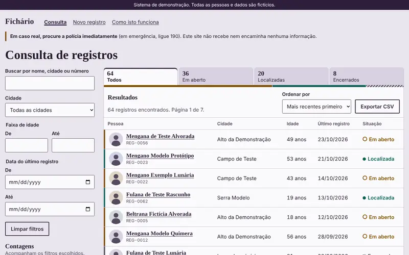

# Fichário



Fiz este sistema como demonstração do que sei construir: um cadastro de pessoas que dá para buscar, filtrar, abrir ficha por ficha e aumentar com novos registros. A mesma estrutura serve para estoque, clientes, processos, associados, equipamentos ou qualquer outro cadastro. O tema das pessoas é só um exemplo.

**Todas as pessoas e dados são fictícios.** Não é um serviço oficial, não tem ligação com nenhum órgão público, não recebe nem encaminha informações e nada é vendido ou cobrado aqui. Em caso real, procure a polícia.

Você pode abrir a demonstração em [toshiro01001.github.io/teste-teste](https://toshiro01001.github.io/teste-teste/).

## Para quem não entende nada de programação

O site é uma lista de pessoas inventadas. Nele você pode:

- **Buscar:** digitar um nome, uma cidade ou um número na caixa de busca. A lista muda enquanto você digita.
- **Filtrar:** escolher cidade, faixa de idade e período em "Mais filtros", e separar por situação nas abas acima da lista.
- **Abrir uma ficha:** tocar em um nome para ver todos os dados daquela pessoa e testar o formulário "Tenho uma informação".
- **Baixar planilha:** salvar a lista que está na tela em um arquivo que abre no Excel ou em outra planilha.
- **Cadastrar:** criar um registro novo em "Novo registro". Se algum campo estiver errado, a tela aponta qual e explica o motivo.

O que você cadastra fica só na aba aberta e some ao recarregar a página. Nenhum formulário envia nada para ninguém.

## Para quem entende um pouco: como funciona

O sistema tem duas partes que conversam: a tela, que roda no navegador sem instalar nada, e a fonte dos dados. A tela é sempre a mesma, mas os dados podem vir de dois lugares:

| Modo | De onde vêm os dados | O que acontece no cadastro |
| --- | --- | --- |
| Estático (o que está publicado no GitHub Pages) | O arquivo `dados/registros.json`, guardado junto com o site | Fica só na aba aberta. Nada sai do navegador. |
| API (um servidor que responde aos pedidos da tela) | Programa em Java em `servidor-java/` | Fica na memória do servidor até ele ser desligado. |

Cada ficha e cada busca tem endereço próprio: copiando o link da barra do navegador, a mesma tela abre em outro aparelho. O rodapé mostra de onde os dados estão vindo. A tela funciona pelo teclado e com leitor de tela.

## Para quem entende muito: detalhes técnicos

### Organização dos arquivos

- `index.html` e `assets/` são a tela, em HTML, CSS e JavaScript sem bibliotecas, sem etapa de build e sem nada carregado de terceiros. As rotas e os filtros moram no hash do endereço.
- `assets/app.js` tem as duas fontes de dados (JSON estático e API) com as mesmas funções, então o resto do código não sabe de qual está lendo.
- `assets/config.js` guarda o endereço da API publicada (vazio usa o JSON).
- `dados/registros.json` são os 64 registros iniciais, usados pelos dois modos.
- `servidor-java/src/fichario/` tem a API, com `Json` (leitor e escritor próprios), `Validacao` (regras de entrada), `Repositorio` (dados em memória), `Api` (rotas HTTP) e `Servidor` (linha de comando).
- `servidor-java/sql/esquema.sql` documenta as tabelas para guardar tudo em banco. **O servidor desta demonstração não usa banco**, porque Java puro não traz driver e o projeto não baixa dependências. Para ligar um banco, troca-se o `Repositorio` por uma versão com JDBC.
- `tests/` tem os testes (abaixo). `PoliciaIndex/lista.html` só redireciona o endereço antigo. `404.html` é a página de erro do GitHub Pages.

### Segurança

- `Content-Security-Policy` com `default-src 'none'`: só scripts, estilos e imagens do próprio site, e conexões só para o próprio site e para `localhost`.
- Todo dado variável entra na página como texto (`textContent`), nunca como HTML.
- As mesmas regras de validação rodam na tela e no servidor. O servidor responde 400 com o motivo por campo.
- O servidor só permite alterar dados (POST, PUT, DELETE) a partir de origens autorizadas e recusa corpos acima de 64 KB.
- O parâmetro `?api=` só aceita `localhost` e `127.0.0.1`.
- O CSV protege contra injeção de fórmulas em planilhas.
- Não há autenticação. Numa publicação real, a API ficaria atrás de HTTPS com login.

## Como rodar

### Só a tela (modo estático)

Precisa de um servidor local, porque o navegador bloqueia a leitura do JSON quando a página é aberta direto do disco:

```sh
python3 -m http.server 8000
```

Depois abra `http://localhost:8000/`.

### Com a API Java

Precisa do JDK 17 ou mais novo. Se faltar, no Ubuntu: `apt-get install -y default-jdk-headless`.

```sh
cd servidor-java
javac -encoding UTF-8 -d out src/fichario/*.java
java -cp out fichario.Servidor --porta 8080
```

Em outro terminal, na raiz do projeto, sirva a tela como acima e abra:

```
http://localhost:8000/?api=http://localhost:8080
```

O rodapé da tela mostra de onde os dados estão vindo.

### Apontar a tela para uma API publicada

O parâmetro `?api=` só aceita `localhost` e `127.0.0.1`, de propósito. Para um endereço definitivo:

1. Coloque o endereço em `assets/config.js`, no valor de `window.FICHARIO_API`.
2. Acrescente o mesmo endereço ao `connect-src` do `Content-Security-Policy`, no `index.html`.
3. Ligue o servidor autorizando a origem da tela, sem barra no fim: `java -cp out fichario.Servidor --host 0.0.0.0 --origem https://usuario.github.io`.

## API

| Método e rota | O que faz |
| --- | --- |
| `GET /api/saude` | Confere se o servidor está de pé |
| `GET /api/registros` | Lista, com `busca`, `cidade`, `situacao`, `idadeMin`, `idadeMax`, `dataDe`, `dataAte`, `ordenar`, `pagina`, `tamanho` (até 100) |
| `GET /api/registros/{id}` | Uma ficha |
| `POST /api/registros` | Cria |
| `PUT /api/registros/{id}` | Atualiza |
| `DELETE /api/registros/{id}` | Apaga |
| `POST /api/registros/{id}/informacoes` | Guarda uma informação na memória |
| `GET /api/resumo` | Contagens por situação, cidade e faixa de idade, com os mesmos filtros da lista |

Exemplo:

```sh
curl 'http://localhost:8080/api/registros?cidade=Serra%20Modelo&ordenar=nome&pagina=1&tamanho=5'
```

Erros de entrada voltam com status 400 e o motivo por campo:

```json
{"erro":"Há campos inválidos.","campos":{"idade":"Informe um número inteiro de 18 a 110. Esta demonstração só usa adultos fictícios."}}
```

Outros status usados: 404 (não existe), 405 (método errado), 413 (corpo acima de 64 KB), 415 (corpo que não é JSON), 403 (origem não autorizada), 507 (limite de dados da demonstração).

## Testes

```sh
sh tests/rodar-tudo.sh
```

- `tests/java/`: testes da API sem biblioteca externa, com o servidor real numa porta livre, incluindo entradas inválidas.
- `tests/testar-sql.py`: executa o esquema em SQLite e confere restrições e consultas.
- `tests/e2e.js`: percorre os fluxos no Chromium com Playwright, em 1366x800, iPhone 13 e 320 px, nos dois modos, e confere que os dois modos dão os mesmos resultados.

## Tecnologias

HTML, CSS e JavaScript sem bibliotecas; Java 17 com `com.sun.net.httpserver`; SQL; Playwright e Python só nos testes.

---

Desenvolvi este projeto e usei o Claude, da Anthropic, como ferramenta durante o desenvolvimento.
